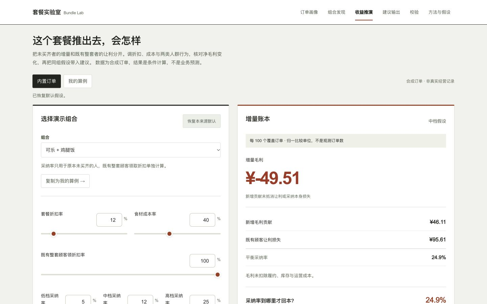

# Bundle Lab

[中文](README.md) · [Project index](https://github.com/AndyZhang666666/AndyZhang666666/blob/main/PROJECTS.en.md) · [Live demo](https://andyzhang666666.github.io/bundle-lab/)

Why can a frequently bought combination earn less after a discount?

Development branch `feat/product-depth-20261101` adds up to three immutable scenario snapshots, changes relative to baseline A, a choice reason and portable comparison cards. The discount-by-adoption map calls the existing calculation for every cell; clicking previews, explicit confirmation applies. Product, discount and middle adoption lead the worksheet, with population/cost inputs disclosed on demand. [Implementation and checks](docs/STRATEGY-WORKBENCH.md). This local iteration awaits the combined portfolio review; live links still show the previous release.



<!-- github-evidence-20261031 -->

[Design decisions](docs/DECISIONS.md) · [Validation records](docs/VALIDATION.md) · [PR core checks](https://github.com/AndyZhang666666/bundle-lab/actions/workflows/checks.yml)

## One discount, two customer groups

- Use basket association to propose a candidate, not establish discount impact.
- Separate incremental contribution from discounts to customers who already buy the full basket.
- Use the same assumptions in discovery, simulation, advice and exports, including negative results.

## Walkthrough

1. Pick an illustrative basket or enter your own 2–3 products. Set discount and middle adoption, then inspect population and cost assumptions.
2. Keep baseline A, copy its inputs, adjust and keep B. Compare changed assumptions, new contribution, discount leakage and break-even per 100 covered orders.
3. Preview other discount/adoption conditions in the map before applying them. Select a scenario, record why and export the comparison.
4. Inspect the synthetic orders and basket associations as supporting evidence; built-in proposals and validation plans remain available.

## Run mode and limits

Uses 4,000 synthetic orders and uncalibrated adoption assumptions. The core flow runs in the browser; optional model rewriting is labelled as an unreviewed draft.

The examples support product reasoning, not measured business outcomes. Inspect population definitions, costs and uncalibrated assumptions before applying the result to a real experiment.

## Develop locally

```sh
npm ci
npm run dev
```

Open `http://localhost:3000/bundle-lab/`. The repository base path is part of the URL.

## Reproduce the core checks

```sh
npm run test:rules
npm run test:simulation
npm run build
```

These commands are provided for reproduction; this documentation update did not run a new model benchmark.

## Documentation

- [Product scope](docs/PRD.md)
- [Assumptions and formulae](docs/ASSUMPTIONS.md)
- [Design decisions](docs/DECISIONS.md)
- [Validation records](docs/VALIDATION.md)
- [Implementation details and original records, Chinese](README.md)

Use the repository’s existing licence and notices. This update does not change usage rights.

[PR core checks](https://github.com/AndyZhang666666/bundle-lab/actions/workflows/checks.yml) reuse the deterministic checks and static build. Only the main-branch Pages workflow deploys.

## Personal inputs and portable results · 2026-11-01

This update adds personal inputs and a portable result, with the reviewed implementation integrated through a release branch. Manual scenarios share the existing two-population contribution model. Outputs use 100 covered orders as a normalised comparison unit, not an observed sample size or a business forecast. Built-in and manual drafts are stored separately.
