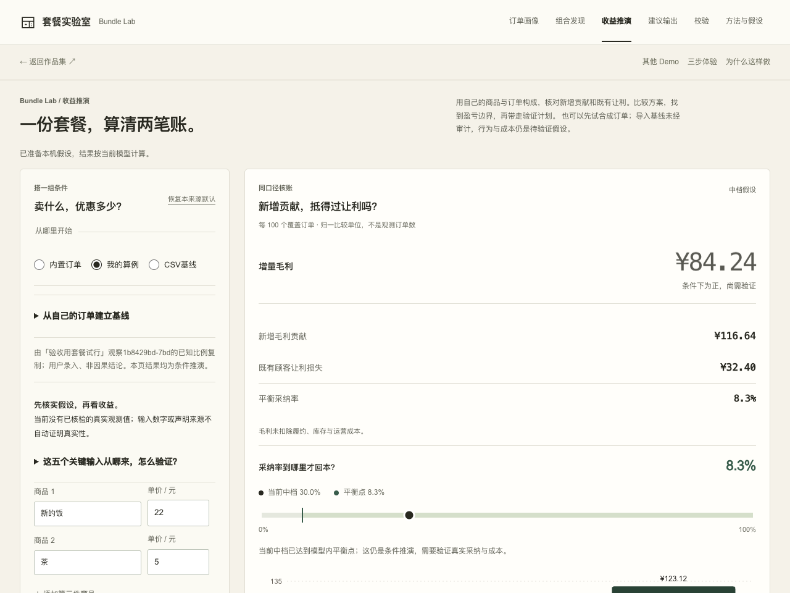

# Bundle Lab · 套餐实验室

2026-11-09 布局打磨：矩阵提前、账本去重、两项经济边界并排；原计算和状态契约保持。[前后截图与实际操作记录](docs/LAYOUT-POLISH-20261109.md)。

**2026-11-09 审阅通过，按真实提交历史发布本轮升级。** [发布范围与验证](docs/RELEASE-20261109.md)

用自己的商品和订单构成，回答一个具体问题：新增购买的毛利，能不能抵消给既有顾客的让利？结果按每100个覆盖订单归一，保留亏损和不可达状态。

本轮新增：

- **自己的基线：**覆盖数与已买齐数辅助输入；上传或粘贴CSV（2MB／10,000行／100SKU），预览2–3件商品，展示明细单价分布，确认统一参考价后应用。数量、实付和退款不进入模型。
- **可解释边界：**同一个两类人群引擎求最高保本折扣，直接指出新增贡献、既有让利和当前矛盾；假设卡与方案比较卡使用同一结果。
- **能执行的下一步：**把当前输入冻结为验证计划，补充分流、期间、指标和护栏；后续追加试验／对照的计数与成本来源。未知值保持未知，显示与原假设的差异。
- **明确再采用：**观察比例先预览，确认后从冻结计划创建新手工假设；原CSV、计划与A/B/C方案不被改写。计划、观察和出处随Markdown／JSON导出。

三种来源分别保存；导入失败和取消都保留当前输入。所有主流程在浏览器完成，无需Key。没有真实订单时仍可直接做归一算例；用户录入或CSV导入不等于已审计观测，也不生成因果提升或最优定价。

[本轮设计、数据契约与复验路径](docs/PRODUCT-DEPTH-20261109.md) · [更新记录](CHANGELOG.md) · [English](README.en.md)

## 本轮建议体验路径

1. 进入[收益推演](https://andyzhang666666.github.io/bundle-lab/simulate/)。先试内置组合，或“从自己的订单建立基线”下载模板／粘贴CSV。
2. 核实覆盖口径与参考价；改折扣和采纳，读同一账本中的贡献、让利、最高保本折扣和平衡采纳率。
3. 留A，改一个条件留B；在条件地图只预演，确认才应用。选方案或暂不选择，并说明理由。
4. 为当前工作输入写验证计划。后续填两组计数，检查缺失项和比例差异；需要时明确复制为新假设、另存方案，带走比较卡与计划。

复现检查：`npm run test:simulation`（26条既有检查）＋ `npm run test:depth`（11条本轮检查）＋ `npm run test:rules`（21条原规则）＋ `npm run build`。本地已通过；另通过1280／390真实Chrome的14组新任务检查（含下载、坏输入、损坏草稿及存储禁用），见上述证据目录。本轮已获发布授权，部署与线上核对见发布记录；没有把自动化次数写成真实用户效果。

<details>
<summary>此前迭代与发布记录（保留历史状态）</summary>

2026-11-03: 关键假设标来源和验证方式，新增贡献与让利分开；微小正柱清晰可见，未保存名称和理由可恢复。 [Release scope and verification](docs/RELEASE-20261103.md).

2026-11-03 最后细节版已在本地验证，计算与状态约定保持，未发布。[修改及验证](docs/FINAL-DETAIL-20261103.md)。

本轮独立任务复验已完成，首轮失败项已修复；仍只在本地，未推送或上线。详见 [独立验收与未测边界](docs/INDEPENDENT-REVIEW-20261103.md)。

2026-11-03 本地验收修复：其他工具在新标签打开；未提交文字与确认结果分开恢复，避免导航或刷新丢失。见 [具体行为和验证](docs/DRAFT-RECOVERY-20261103.md)。尚未推送或上线。

2026-11-03 本地迭代，尚未发布：采纳、人群、成本、原消费与领折扣率分别标来源及验证方式；合成和手动输入都不会被认证为真实观测。三档结果可直接读数，假设卡和比较卡带完整依据。25项模型／状态检查、21项规则检查及构建通过；实际文件与手机操作已核对。 [验收与边界](docs/TASK-CLARITY-20261103.md)。

2026-11-02 视觉打磨已通过用户审阅，获批合并发布：[设计取舍、官方参考与前后截图](docs/VISUAL-CRAFT-20261102.md)。本次保留原有产品功能；发布记录见仓库合并提交 与 Pages 工作流。


</details>

[在线体验](https://andyzhang666666.github.io/bundle-lab/) · [English](README.en.md) · [作品索引](https://github.com/AndyZhang666666/AndyZhang666666/blob/main/PROJECTS.md)

经常一起买的组合，为什么打折后反而可能少赚？

2026-11-02 获批发布：收益工作区新增最多三份方案快照、相对 A 的输入差异、选择理由与比较卡。折扣×采纳率条件地图逐格使用原收益函数，先预演再明确应用；商品、折扣和中档采纳为主输入，其余假设展开核实。恢复默认时清除旧操作提示，已保留方案不变。模型检查、静态构建与整合浏览器审阅已完成，本次随官网同步发布。[实现与验证](docs/STRATEGY-WORKBENCH.md)。

2026-11-01 更新：从[收益推演](https://andyzhang666666.github.io/bundle-lab/simulate/)进入。新增“我的算例”，支持 2–3 件商品、两类人群与独立假设草稿；每100个覆盖订单展示增量账本，可复制或导出 Markdown 假设卡。沿用原计算模型，不把归一单位当成观测订单量。[改动与验证](docs/USABLE-SCENARIOS.md)。



<!-- github-evidence-20261031 -->

[设计取舍](docs/DECISIONS.md) · [验证说明](docs/VALIDATION.md) · [PR 核心检查](https://github.com/AndyZhang666666/bundle-lab/actions/workflows/checks.yml)

## 同一个折扣，两类人群

- 共购信号用于发现候选，不能直接证明打折有效。
- 把未买齐者的新增贡献与原本买齐者的让利分开算。
- 候选、推演、建议与导出共用假设，负收益也照常呈现。

## 建议体验路径

1. 从收益推演选择演示组合，或填入自己的 2–3 件商品；先改折扣和中档采纳。
2. 核实人群与成本，保留方案 A；复制后调整，另存 B，核对差异和同口径增量账本。
3. 在条件地图预演其他折扣与采纳，确认后才应用。选择方案、写下理由并导出比较卡。
4. 需要查看共购依据时，再进入订单画像和组合发现；内置候选仍可生成规则建议与验证清单。

**运行方式：** 使用 4,000 笔合成订单和未校准的采纳假设。浏览器可完成主流程；可选模型仅做单独标注的草稿润色。

## 本地启动与检查

在完整仓库根目录运行，按 CI 使用 Node.js 22：

```sh
npm ci
npm run dev
```

打开 `http://localhost:3000/bundle-lab/`，保留仓库路径。选择候选组合进入推演，调整折扣或采纳率，新增贡献、既有让利和净变化会一起更新。 默认体验无需模型密钥。

已有的确定性检查可以单独运行：

```sh
npm run test:rules
npm run test:simulation
```

PR 工作流复用这些检查并完成静态构建；部署仍只由 `main` 的 Pages 工作流执行。上述检查不调用付费模型，也不代表模型效果评测。

<details>
<summary>展开实现、模型与验证记录</summary>

2026-10-27 界面更新：仅调整展示层，模型和订单不变。详见 [本轮说明](docs/FRONTEND-20261027.md)。

[在线体验](https://andyzhang666666.github.io/bundle-lab/) · [假设与公式](docs/ASSUMPTIONS.md) · [产品取舍](docs/DECISIONS.md) · [验收](docs/VALIDATION.md)

从合成订单发现共购信号，把“原本没买齐者的新增购买”和“既有整套顾客领取折扣”分开核算，再生成一份有验证计划的运营假设。共购不是因果，算得出增量不等于已经赚到钱。

## 完整体验

1. 看订单画像，区分观察到的结构与原因假设。
2. 按分群、排序和 lift 下限检查候选；展开规则方向与样本规模。全部订单的候选可直接带入推演。
3. 调折扣、成本、未买齐者三档采纳率和已买齐者领折扣率。账本列出新增贡献与让利损失，平衡点和图表共用同一计算。
4. 最多比较三个组合。排名按中档增量毛利 × 覆盖单数；组合覆盖重叠，结果不可相加。可清空比较、恢复默认、刷新恢复草稿和导出 JSON。
5. 将当前假设带到建议页，重新评估全部候选。中档毛利不为正的组合不进推荐；没有候选时保留空结果。导出规则 Markdown、结构化依据和下一步验证清单。
6. 可选模型仅润色。不会自动请求，Key 只留页面内存；支持取消、超时和失败回退。模型草稿单独标“未核对”，正式导出始终为规则版。

六页导航、原有红色数据强调与技术栈保留；修复窄屏导航缺项、选组带入、内部表格滚动、对比勾选无法添加和旧假设不同步等问题。

## 核心洞察：采纳率不是同一群人的采纳率

旧推演对所有覆盖订单统一乘采纳率，却在平衡公式中假设已买齐者都会领折扣，且把全体平均花费当作未买齐者基线。两处的分母与行为假设不一致。

模型 **two-population-v2-2026-10-25** 使用：

```text
L = 组合原价；B = 套餐价；P = 覆盖人群平均组合内花费
h = 已买齐者占比；r = 已买齐者领折扣率
a = 未买齐者采纳率；c = 食材成本率
S部分 = (P − hL) / (1 − h)
g = B − cL − (1 − c) × S部分
Δ毛利 / 覆盖单 = (1 − h) × a × g − h × r × (L − B)
平衡 a = h × r × (L − B) / [(1 − h) × g]，仅在分母为正时
```

手算例：原价20、套餐价18，20%的覆盖订单原本买齐，其余原花10，成本40%，未买齐者采纳50%，已买齐者全部领折扣。新增毛利贡献1.60，既有让利0.40，净变化 **1.20/覆盖单**；平衡采纳率12.5%。采纳为零时仍损失0.40，不能显示“零影响”。

没有覆盖订单则拒绝估算；全部已买齐、零价、100%成本与不可达平衡点分别处理，不隐藏负数。毛利不含运营、履约等成本，不是净利润。

## 观察与证据

关联规则采用 Apriori；支持度、置信度和 lift 来自内置订单。三元组合的 lift 是最强分割方向的比值，不能解释成“买任意一件就会买齐的概率”。

4000笔合成订单、32个SKU，固定种子20260913；不含实习公司数据。21项手算对照保留；召回与样本阶梯脚本检查这一生成器下的表现，不证明真实业务“2000单即可用”。

采纳、成本和领折扣行为未经真实业务校准。没有统计显著性、价格弹性、份量变化、曝光选择、库存或跨订单蚕食建模。当前不支持上传CSV；观察信号用于提出实验，不产生收益承诺。

## 开发与验证

Next.js 15 / React 19 / Recharts，静态导出至 GitHub Pages。挖掘在构建期完成，推演与草稿在浏览器计算。无需模型或 Key 即可完成主流程。

```bash
npm ci
npm run test:rules       # 原有21项手算
npm run test:simulation  # 新增两类人群、状态与导出边界
npm run recall          # 固定合成样本召回
npm run robustness      # 样本阶梯与阈值敏感度
npm run build
```

本轮真实浏览器任务：启动本机服务后，`TEST_URL=http://127.0.0.1:3000/bundle-lab/ node scripts/test-product-depth-browser.mjs`。可指定 PLAYWRIGHT_MODULE、EVIDENCE_DIR。旧 `scripts/test-browser.mjs` 保留原断言，其中部分选择器在本轮基线已失效，具体差异见本轮验收说明；未通过改断言掩盖问题。

`results/playbook-samples/` 为旧版本历史样本，不代表新模型验收。本轮没有执行付费模型脚本。

MIT，沿用既有许可。真实分阶段修改见 [CHANGELOG](CHANGELOG.md) 和提交历史。

</details>
