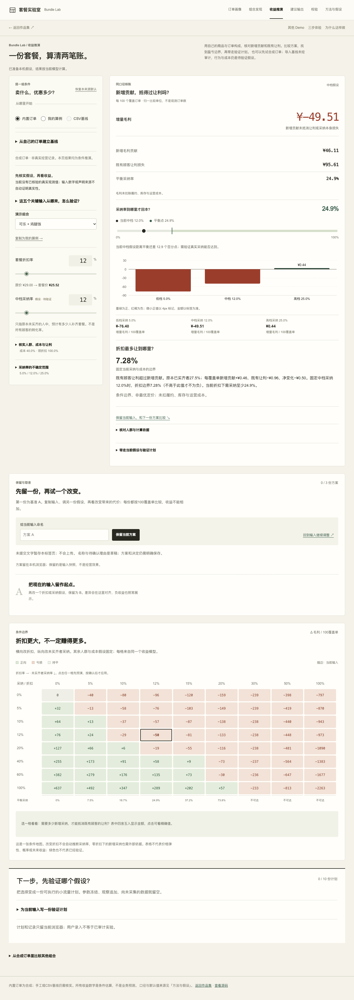
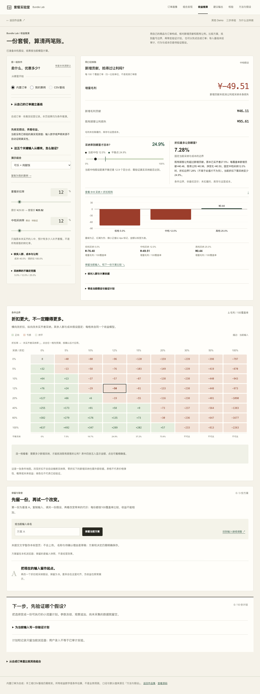
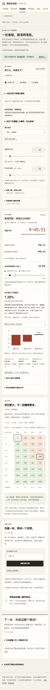

# 收益推演布局打磨 · 2026-11-09

原页面在账本和回本标尺中重复突出平衡采纳率，敏感性矩阵位于方案对比之后。保留原有计算和解释，本轮调整阅读顺序及两个经济边界的排布。

- 移除账本重复的平衡采纳率行，保留带当前条件和尺度说明的回本标尺。
- 桌面将回本采纳率与最大保本折扣并排；手机自然堆叠，内容不省略。
- 矩阵紧接主工作台，方案快照对比在后。关键结果处有原生锚点入口，矩阵区域与首格均支持键盘定位。
- 图表、预演、采用、A/B/C快照及冻结验证计划继续使用原模型和状态，不新增推演公式。

## 真实前后测量

默认内置演示、1280×900、浏览器页面坐标：

| 指标 | 修改前 | 修改后 |
| --- | ---: | ---: |
| 主工作台高度 | 1410px | 1198px |
| 左右工作区底边差 | 292px | 80px |
| 敏感性矩阵起点 | 2250px | 1498px |
| 页面高度 | 3612px | 3400px |

矩阵提前752px。两个经济边界在桌面均从689px开始、各宽391px；390px下按单列阅读。矩阵保留内部横向浏览，整页不横向溢出。并非把所有功能强塞到一个首屏。

## 验证与边界

37项既有核心/状态检查、21项原规则及生产构建通过。真实Chrome1280/768/390检查、键盘锚点、减少动态效果均通过；矩阵预演不写草稿，取消/明确采用保留既有方案，冻结计划及Markdown/JSON实际下载、刷新恢复通过。没有页面脚本异常或模型调用。

这些检查使用内置演示和虚构验收条件，不代表真实商家收益、因果效果或真人使用研究。[前后测量](assets/layout-polish-20261109/before-metrics.json) · [实际操作及改后测量](assets/layout-polish-20261109/after-metrics.json)。

实现提交`ad2e30c97a84227645c3b6a8fa6067180108fdef`仅涉及三个展示文件；`lib/`计算与存储模型、依赖和锁文件不变。用户已授权正常PR合并发布，精确main、Pages与公开站复核记录在对应PR；本地证据不代替部署成功。
