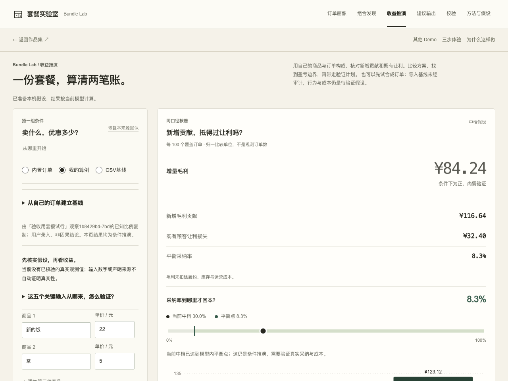
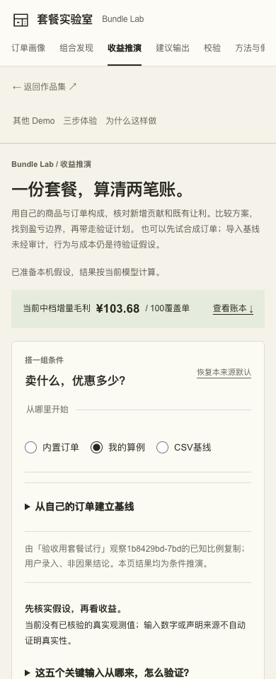
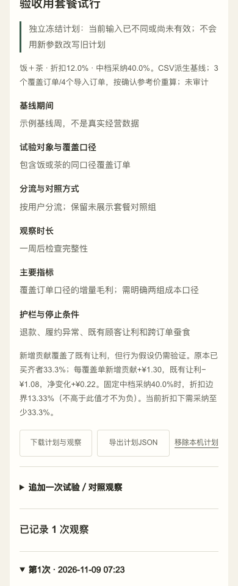

# Bundle Lab · 自有基线与验证闭环

日期：2026-11-09。开发分支 `feat/bundle-product-depth-20261109`，基线 `466db00`。本轮保持当前线上版本，尚未合并或发布。

## 具体问题和取舍

经营者能调一个折扣，并不意味着他有一份可以交给同事执行的方案。旧工作区已有三份方案和敏感性地图；本轮补齐两端：自己的基线怎么进来，推演之后该采什么数据。

本轮用户是准备试行套餐的运营或增长人员。主任务是带入商品，核对两个人群的账，保留选择和验证方法。不是自动定价、因果分析或完整POS核账。

- 商品出现、覆盖订单、原已买齐者、参考价、折扣、补齐、让利是工作区的词汇。
- 继续用工作纸的浅底、墨色金额、红褐损失、墨绿贡献；颜色表达账本方向，不给CSV或用户观察贴“已验证”绿标签。
- 主签名是同一组条件下的贡献—让利—净变化，与两个盈亏边界对齐。它同时出现在主账本、三档、方案对比、条件格点和导出。
- 不新增大指标卡墙，不把导入做成一整套向导，不引入多层风格选项卡。主输入保留在约340px侧栏，完整账本占余宽；CSV和实验字段按任务展开。
- 标题约22–28px、正文14px、来源12–13px，结果44px；金额等宽。新控件至少44px，表格只在内部滚动。沿用原生输入、按钮、下拉和details，复用已有焦点与减少动态效果规则。

## 用户能完成什么

1. 先用内置合成组合理解账本，或填写2–3件商品。
2. 有覆盖数时填覆盖单数和已买齐单数；没有订单时直接使用未核实的比例，结果仍按100覆盖单归一。
3. 也可以下载CSV模板或粘贴自己的明细；预览、选择商品、确认统一参考价后才应用为独立CSV基线。
4. 改折扣、成本、采纳和领折扣条件，看贡献、让利、净变化、平衡采纳及最高保本折扣。
5. 保存A/B/C，读相对A的变化；条件地图点击只预演，确认才采用。
6. 为当前工作输入写试验对象、期间、分流/对照、时长、主要指标和护栏，冻结为计划。
7. 追加两组计数和成本来源。未知字段与零分母保留未知，显示相对冻结假设的比例偏差。
8. 需要采用观察时先看影响预览。确认后，从冻结计划生成新的手工假设；原CSV、原计划及已保存方案保持不变。再保存一个新方案，而不是改历史。
9. 带走假设卡、方案比较卡或单份验证计划。Markdown与JSON保留来源、模型、归一口径、选择理由和描述性观察。

## 数据与模型

### 计算模型不变

`lib/simulate.js` 与模型版本 `two-population-v2-2026-10-25` 不改。界面、图表、方案和导出继续调用 `simulateStats` / `simulateOne`。没有把导入适配当成新收益模型。

最高保本折扣是原函数上的边界查询：固定人群、成本、领折扣和中档采纳，先检查0%与100%，再在区间内查找 `marginLift >= 0` 的最高折扣。显示百分比向下取两位小数，避免四舍五入把亏损侧显示为可承受。全区间持平写“无增量”；零采纳、全部原已买齐、零领折扣、零成本分别保留含义。

诊断优先指出采纳本身为负、既有让利超过贡献、全部已买齐或当前持平等情况。不把条件边界叫最优折扣；毛利仍未扣履约、库存与运营成本。零折扣的新增采纳也需要外部依据。

### CSV仅建立商品构成

必需列 `order_id,sku`，可选 `unit_price`。UTF-8，最多2MB、10,000明细行、100SKU；支持BOM、CRLF、引号内逗号/换行、双引号转义。错误指出行号；空数据、坏列、非法单价、未闭合引号直接报错，不吞行。额外列列明未使用。

按订单号聚合，同一订单内同一SKU只计出现一次。选择2–3件商品，至少含其中一件就是覆盖订单，包含全部是已买齐订单。用确认的统一参考价重算所选商品构成消费，得到未买齐人群原消费，再适配到原引擎需要的**全覆盖人群平均消费**。不把组内均值直接传给全体均值参数。

不同明细单价展示价格与行数，缺价显示缺失行数；异价不静默选第一条。即使只有一种价，也需要用户确认参考价与基线口径。模板包含未使用的口径说明列；数量、促销实付及退款均不参与模型。

基线来源带实际导入单数、覆盖数、已买齐数、明细行数与参考价；结果分母仍是归一100单。CSV元数据在恢复、方案保存和计划保存时与商品/价格/比例核对，不仅校验JSON能否解析。

### 独立保存和恢复

- 既有内置草稿、手工草稿、最多三份方案快照的结构和旧读取路径保留。
- CSV：`bundle-lab:csv-baseline:v1`。保存派生基线，不把原始订单明细写入方案。上传前文字草稿暂存本标签页。
- 手工计数来源随报告保存；编辑商品或比例后清除旧计数依据，避免把不同商品的计数当现有证据。
- 验证计划：`bundle-lab:validation-plans:v1`，最多10份，单份最多10次追加观察；可导出后明确移除本机记录。
- 计划绑定模型和输入签名，字段、来源和参数冻结；观察单独追加。观察输入草稿绑定计划，切换计划不自动套用另一份未提交草稿。
- 对损坏的手工、CSV或计划记录保持写锁。仍可在内存操作与导出；只有明确替换才恢复写入。存储被禁用不阻止计算或下载。

### 观察不是实验结论

两组分别录覆盖、原未买齐、补齐、原已买齐领折扣人数。检查子集和互斥人数边界；采纳率分母为原未买齐者，领折扣率分母为原已买齐者。缺失和零分母不补0。

界面和Markdown都显示已知/缺失字段，以及相对计划中档采纳、领折扣假设的百分点差。对照组记录保留，但不自动给出显著性、因果提升、价格弹性或全量上线判断。成本来源为空时明确缺失，不将录入比例冒充已核算利润。

采用操作先预览将使用哪份冻结计划、哪些已知比例以及替换哪个当前手工输入；未知比例保留冻结值。只有确认才创建新工作假设，不改旧CSV、快照或计划。

## 验证记录

实际运行的检查：

- `npm run test:simulation`：26条既有模型／状态检查，未修改原断言。
- `npm run test:depth`：11条本轮检查，覆盖原引擎折扣边界、CSV解析/归一/分布、坏来源拒绝、计数边界、计划冻结、观察分母与互斥、导出与来源一致性。
- `npm run test:rules`：21条既有手算规则检查。
- `npm run check:release`：58个候选的份额、受限诊断、basePath链接检查。
- `npm run build`：Next静态生产构建通过。

不修改旧 `scripts/test-browser.mjs` 的断言。它在本轮基线中已使用旧选择器，例如“选择组合”而当前控件为“演示组合”，旧“导出本组推演”入口也不再存在。新增浏览器回归单独记录在下方，避免把测试改绿伪装成既有行为通过。

### 新任务浏览器检查

已通过隔离Chrome的14组实际操作检查。使用本分支生产静态构建，视口1280×960和390×960。完整列表与实际下载产物见 [证据目录](assets/product-depth-20261109/README.md) 和 [机器可读结果](assets/product-depth-20261109/summary.json)。

| 任务 | 实际结果 |
| --- | --- |
| 上传含重复行、异价、额外数量列的CSV | 商品出现去重；4导入单／3覆盖单／100归一结果分开；价格行数展示，确认统一价后才应用 |
| 坏引号CSV、取消预览 | 明确行号；活动CSV草稿与账本逐字保持 |
| 保存A/B，点击条件格点 | 两份独立快照；点击只预演，不改账本或旧方案 |
| 冻结计划并回填两组计数 | 参数冻结；显示相对假设的百分点偏差；补齐81人／原未买齐80人的矛盾输入被拒绝，旧观察保持 |
| 采用观察比例 | 预览阶段输入不变；明确采用后从冻结计划生成新手工输入，原CSV、快照和计划不改 |
| 下载及刷新 | 当前JSON与原引擎重算相同；Markdown、比较JSON、单计划保留来源、诊断和观察；刷新分别恢复 |
| 手工计数与编辑 | 200覆盖／40已买齐生成20%；更改商品后撤销计数依据，清除旧操作提示 |
| 价格留空 | 隐藏当前账本并阻断导出，不把旧图表当新结果 |
| 390及键盘 | 无页面横向溢出；Enter展开收起，数字输入可用；所有可见主工作区按钮≥44px |
| 损坏CSV／计划 | 旧值保持写锁；新计划仅内存可用；明确恢复后才替换计划，未触碰旧CSV |
| 存储禁用 | 390下账本、内存计划及JSON下载仍可用，明确提示未写入本机 |
| 错误与动态效果 | 无页面脚本错误；减少动态效果媒体设置下操作路径保持 |

浏览器检查发现旧方案表的两个“选择这份方案”按钮只有40px，已修成44px并复验。首轮本机Python服务还发生并发资源连接重置；更换高并发本机服务后复验通过，没有把未加载页面算作完成。







复现新增浏览器任务（已安装Playwright及Chrome时）：

```sh
npm run dev
TEST_URL=http://127.0.0.1:3000/bundle-lab/ node scripts/test-product-depth-browser.mjs
```

可用 `PLAYWRIGHT_MODULE` 指定已安装模块，`EVIDENCE_DIR` 指定产物目录。脚本不改旧浏览器断言，不增加线上追踪。

## 尚未覆盖与使用边界

真实商家或访客的有效任务完成率尚未采集；没有用自动化次数冒充用户数据。未做POS系统接入、数量/支付/退款核账、返利叠加、显著性或因果估计。CSV与观察未经审计，真实试行需自己核实成本、人群、期间和分流。所有新增流程无需在线模型；未请求付费接口。
