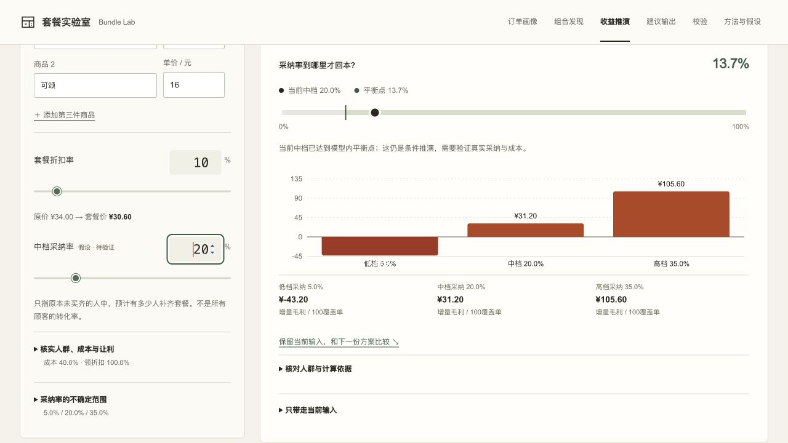

# 输入依据与收益账本 · 本地验收

2026-11-03。分支 `feat/task-clarity-20261103`，基线 `4f3a8f1`；未推送、未合并、未发布。

## 行为与取舍

采纳率、已买齐占比、成本率、未买齐原消费与既有领折扣率各自标来源和待核实条件。来源由数据路径决定，不分析用户的来源文字来认证真实性。内置的人群统计是合成统计，行为／成本是待验证假设；手动输入也没有自动变成真实观测。

输入区先显示口径提醒，逐项验证方式按需展开；行为输入旁保留文字标签。每100覆盖单仍为归一比较单位。原来的新增贡献、既有让利、净毛利、盈亏线及低中高图保留；新增三档可读数值，不依赖颜色或悬浮提示。

同一计算函数继续服务A/B、敏感性、假设卡与建议。各类JSON和Markdown导出携带五项来源与验证方式；历史方案无需迁移，报告在读取时按来源给出依据说明。不新增自动最优方案、业务预设或实际收益预测。

公共说明与三步定位不改草稿。生成文件后保留再次保存的链接；它是生成时的快照。内置／自建草稿、方案和选择理由继续分别保留。

## 实际操作

- 恢复既有咖啡18＋可颂16、已买齐20%、原消费18、成本40%、原买齐领券100%手工假设与A/B。
- A九折／20%采纳：新增99.20、让利68、净31.20、平衡13.7%；B八折／35%：新增78.40、让利136、净−57.60、平衡60.7%。数字仍由原引擎给出。
- 实际下载当前假设和两份比较JSON：五项来源均保留，B负收益和原选择理由保留。
- 清空采纳数值：错误提示，旧结果不作当前结果，导出暂停；恢复35后可继续。
- 点击九折／20%敏感性格点：只预演，原工作输入仍20%折扣；确认应用才变10%／20%，已存A/B不变。
- 手机390无横向溢出，平板820可用；三步定位实际聚焦采纳输入，Esc回触发按钮。

## 检查与边界

25项模拟／自建／方案／草稿保护检查、21项规则检查、发布入口检查和生产构建通过。零采纳、全买齐、不可达、无覆盖单、预演过期及存储失败由确定性测试覆盖；不是全部真实浏览器状态测试。

未做真实订单接入、价格弹性或因果业务验证，未做真机、读屏或减少动态效果运行时切换。独立逐项复验另记。
